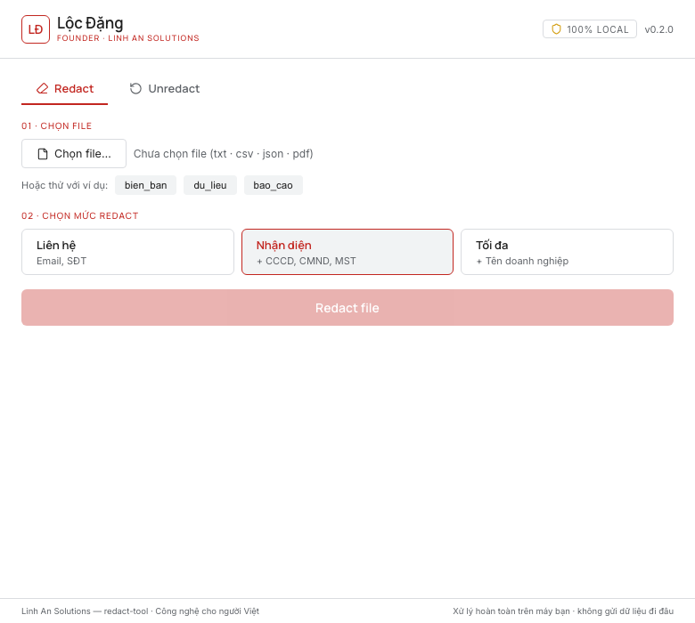
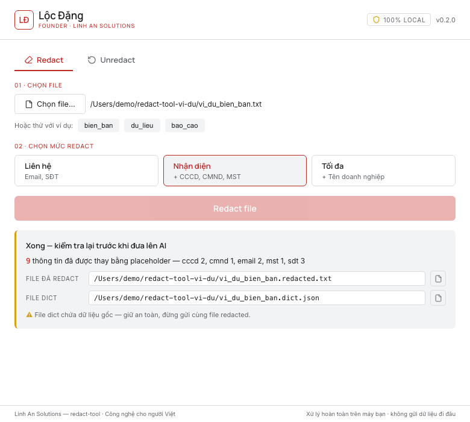
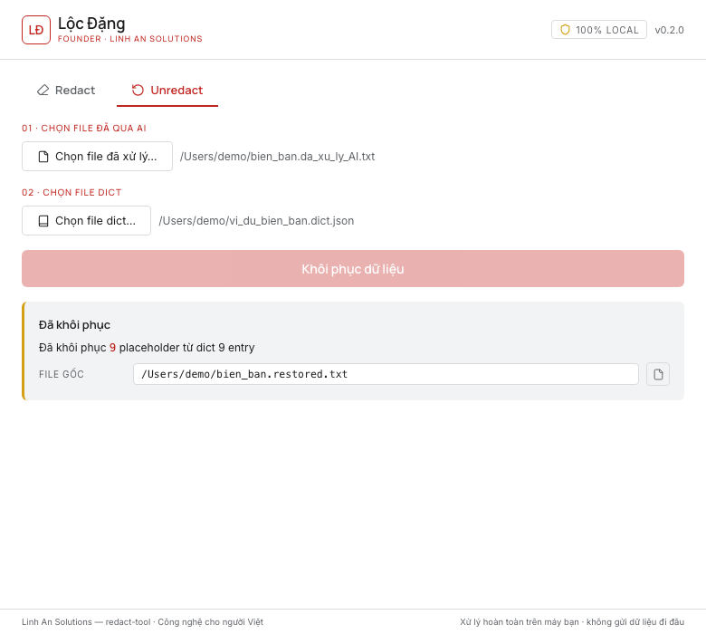

<div align="center">

# Redact GUI

**Redact thông tin nhạy cảm trước khi đưa tài liệu lên AI**

`100% xử lý local · zero telemetry · không network · macOS + Windows`

Tác giả: **Lộc Đặng** — Founder, **LINH AN SOLUTIONS** — *Công nghệ cho người Việt*

</div>

---

## Vì sao cần tool này?

Quy định cấm cán bộ, công chức đưa dữ liệu mật lên các hệ thống AI. Nhưng công việc
thực tế vẫn cần AI hỗ trợ soạn thảo, tóm tắt, phân tích. **Redact GUI** giải bài toán
ngược: giữ nguyên giá trị sử dụng của tài liệu, xóa đi phần dữ liệu cá nhân trước khi
tài liệu rời khỏi máy bạn.

**Nguyên tắc thiết kế: tool này không có bất kỳ dòng code network nào.** Toàn bộ xử lý
diễn ra trên máy bạn — download, chạy offline, rút mạng vẫn chạy đủ chức năng.

## Cài đặt

Tải bản tương ứng nền tảng từ [Releases](../../releases):

| Nền tảng | CLI | GUI (app có sẵn 3 file ví dụ) |
|---|---|---|
| macOS (Apple Silicon) | `redact-cli-aarch64-apple-darwin.tar.gz` | `Redact-GUI_…_aarch64.dmg` / `.app.tar.gz` |
| Windows (x64) | `redact-cli-x86_64-pc-windows-msvc.zip` | `Redact-GUI_…_x64-setup.exe` / `.msi` |

| Ubuntu/Linux (x64) | `redact-cli-x86_64-unknown-linux-gnu.tar.gz` | `.deb` / `.AppImage` / `.rpm` |

macOS: giải nén, `chmod +x redact-cli`, đưa vào PATH.

**Lần đầu mở app macOS**: nhấn đúp sẽ hiện cảnh báo vì app ad-hoc sign (không có
chữ ký Apple Developer). **Chuột phải vào app → Open → Open** — chỉ cần làm 1 lần,
các lần sau mở bình thường. Windows tương tự: SmartScreen → "More info" → "Run anyway".

Ubuntu: `sudo apt install ./Redact.GUI_0.2.1_amd64.deb` (hoặc chạy `.AppImage`:
`chmod +x && ./Redact.GUI_*.AppImage`).

## GUI — hai chức năng: Redact & Unredact

| Tab Redact | Sau khi redact |
|---|---|
|  |  |



*(Ảnh render từ đúng source UI của app — screenshot app thật: [test report](docs/../../releases) kèm mỗi release.)*

Mở app, có 2 tab:

- **Redact**: chọn file (hoặc bấm 1 trong 3 file ví dụ có sẵn) → chọn mức
  (1 · Liên hệ — email/SĐT · 2 · Nhận diện — + CCCD/CMND/MST · 3 · Tối đa — + tên DN)
  → nhận **file đã redact + file dict**.
- **Unredact**: sau khi AI xử lý xong file redacted, chọn file đó + file dict →
  nhận lại file với dữ liệu gốc (`*.restored.*`).

File dict chứa ánh xạ placeholder ↔ dữ liệu gốc — **giữ dict cẩn thận, đừng gửi
đi cùng file redacted** (giữ dict = giữ chìa khóa).

## Sử dụng

```bash
# Xem trước: tool tìm được gì trong file (không ghi gì cả)
redact-cli --dry-run baocao.pdf

# Redact — tạo file mới baocao.redacted.txt cạnh file gốc
redact-cli baocao.pdf

# Redact nhiều file / cả thư mục đệ quy
redact-cli --recursive ./hoso/

# Ghi đè tại chỗ (không backup)
redact-cli --in-place ghi-chu.md

# Chỉ redact một số loại thông tin
redact-cli --patterns cccd,sdt baocao.txt

# Hoặc chọn nhanh theo mức: 1=Liên hệ · 2=Nhận diện · 3=Tối đa
redact-cli --level 2 baocao.pdf

# Redact kèm dict (file ánh xạ để khôi phục sau này)
redact-cli --map baocao.dict.json baocao.txt

# KHÔI PHỤC sau khi AI xử lý xong — cần file dict ở bước trên
redact-cli unredact baocao.redacted.txt --dict baocao.dict.json

# Thư mục đích riêng
redact-cli -o ./da_redact/ hopdong.csv

# Liệt kê pattern có sẵn
redact-cli --list-patterns
```

File gốc **không bao giờ bị sửa** trừ khi bạn dùng `--in-place` rõ ràng.

## Pattern có sẵn

| id | Bắt những gì | Ví dụ |
|---|---|---|
| `cccd` | CCCD 12 số (có thể ngăn cách dấu) | `012345678901`, `0123 4567 8901` |
| `cmnd` | CMND 9 số liền (mẫu cũ; không nhận dạng có separator để tránh bắt nhầm số tiền) | `012345678` |
| `mst` | Mã số thuế (kèm mã đơn vị con) | `0101234567`, `0101234567-001` |
| `sdt` | SĐT VN (0/84/+84, ngách 2-9) | `0901234567`, `0901 234 567`, `+84901234567` |
| `email` | Địa chỉ email | `nguyen.van@coquan.gov.vn` |
| `tendn` | Tên doanh nghiệp/tổ chức | `Công ty TNHH ABC`, `DNTN Hoa Hồng`, `HTX X` |

Mỗi giá trị được thay bằng placeholder nhất quán: cùng một số điện thoại xuất hiện
10 lần → 10 chỗ đều là `[SDT_1]`. Điều này giữ cho AI vẫn hiểu các thực thể trong
tài liệu là **cùng một** khi phân tích.

### Rule tùy chỉnh

Tạo `rules.json`:

```json
[
  {"id": "sohopdong", "label": "HD", "regex": "HD-\\d{4,}"},
  {"id": "sotaikhoan", "label": "STK", "regex": "\\b\\d{12,14}\\b"}
]
```

```bash
redact-cli --rules rules.json baocao.txt
```

## Định dạng hỗ trợ

| Định dạng | Cách xử lý | Output |
|---|---|---|
| `.txt` `.csv` `.md` `.log` ... | regex trực tiếp | `<tên>.redacted.<đuôi>` |
| `.json` | redact từng value, giữ key, output vẫn là JSON hợp lệ | `<tên>.redacted.json` |
| `.xml` | redact text node, giữ nguyên cấu trúc + attribute | `<tên>.redacted.xml` |
| `.docx` `.xlsx` `.pptx` | mở zip, redact text bên trong — **GIỮ NGUYÊN ĐỊNH DẠNG** (định dạng chữ, công thức, layout) | `<tên>.redacted.<đuôi>` |
| `.doc` `.xls` `.ppt` (cũ) | chưa hỗ trợ giữ format — tool sẽ bỏ qua kèm gợi ý chuyển sang dạng mới | — |
| `.pdf` | trích text → redact (PDF scan không có text lớp sẽ không đọc được) | `<tên>.redacted.txt` |

## Redact cả thư mục (folder + subfolder)

GUI: bấm **Chọn thư mục…** → chọn mức → Redact. CLI:

```bash
redact-cli --recursive ./hoso/
```

Kết quả: thư mục `hoso_redacted/` **mirror đúng cấu trúc subfolder**, kèm **một file
`dict.json` chung** cho toàn bộ thư mục (dùng để unredact cả loạt sau khi AI xử lý xong).
File không hỗ trợ (doc/xls/ppt cũ) được bỏ qua và báo rõ.

## Hai chế độ sử dụng (đọc kỹ phần an toàn)

### Chế độ (a) — script thuần ✅ đã implement

Chạy `redact-cli` trực tiếp như hướng dẫn trên. **An toàn tuyệt đối**: binary không
chứa code network, dữ liệu không bao giờ rời máy bạn.

### Chế độ (b) — AI-assist ⚠️ chưa implement

Tương lai: redact xong thì gửi bản đã redact lên LLM API để tóm tắt/phân tích tiếp.
**Kém an toàn hơn chế độ (a)** vì:

1. Dữ liệu (dù đã redact) vẫn rời khỏi máy bạn → phụ thuộc vào phía API.
2. Pattern regex không bao giờ phủ 100% — tên riêng, địa chỉ, ngữ cảnh nhạy cảm
   không có pattern cố định vẫn có thể lọt.
3. Lỗi rule → rò rỉ im lặng: bản redact trông sạch nhưng chưa chắc sạch.

Khi được implement, chế độ này sẽ yêu cầu flag tường minh (`--ai-assist`) kèm
cảnh báo tương tự, và API key do bạn tự cung cấp.

**Khuyến nghị của chúng tôi**: với tài liệu mật, dùng chế độ (a), tự đọc lại bản
redact trước khi đưa đi bất cứ đâu.

## ⚠️ Phạm vi và trách nhiệm

- Tool chỉ **tự động hoá việc che một số thông tin thường được coi là nhạy cảm** — không bảo đảm tuyệt đối văn bản sau redact không còn sót dữ liệu nhạy cảm / dữ liệu mật.
- Việc đưa văn bản đã redact lên các công cụ AI hay không là **trách nhiệm hoàn toàn của người sử dụng**.
- **TUYỆT ĐỐI KHÔNG** dùng tool lên văn bản đã đóng dấu mật, hoặc được coi là mật theo các quy định khác. Quy định về bảo vệ văn bản mật luôn được tuân thủ trước hết.

## Bảo mật & quyền riêng tư

- **Zero telemetry** — không có analytics, không crash report, không "phone home".
- **Không dependency network** — audit thẳng: source không import thư viện HTTP nào.
- **File gốc bất biến** — mặc định luôn ghi ra file mới.
- `--map mapping.json` ghi quan hệ original ↔ placeholder để bạn khôi phục lại
  khi cần — **file mapping chứa dữ liệu nhạy cảm**, đừng commit, đừng gửi đi cùng.

## Giới hạn trách nhiệm — đọc kỹ trước khi dùng

Công cụ này chỉ **tự động hoá việc che một số thông tin thường được coi là nhạy cảm**
khỏi văn bản. Nó **không bảo đảm tuyệt đối** văn bản sau redact không còn sót dữ liệu
nhạy cảm hoặc dữ liệu mật. Việc đưa văn bản đã redact lên công cụ AI hay không là
**trách nhiệm hoàn toàn của người sử dụng**.

**Tuyệt đối không sử dụng công cụ này cho văn bản được đóng dấu MẬT hoặc được coi
là mật theo quy định khác** — các văn bản này không được đưa lên AI dưới mọi hình thức.

## Build từ source

```bash
cargo build --release          # CLI tại target/release/redact-cli
cargo test                     # toàn bộ test
cargo build --release -p redact-gui   # GUI (cần tauri-cli để bundle: npx @tauri-apps/cli build)
```

Cross-compile 2 nền tảng qua GitHub Actions: push tag `v*` → workflow
`.github/workflows/release.yml` tự build macOS (aarch64) + Windows (x86_64)
và đính kèm vào GitHub Release.

Roadmap GUI (Tauri — giữ nguyên Rust core) nằm ở [docs/roadmap.md](docs/roadmap.md).

## Đóng góp

Vấn đề / ý tưởng pattern mới / PR đều welcomed. Xem [docs/design.md](docs/design.md)
để hiểu kiến trúc trước khi sửa core.

## License

MIT © Linh An Solutions
